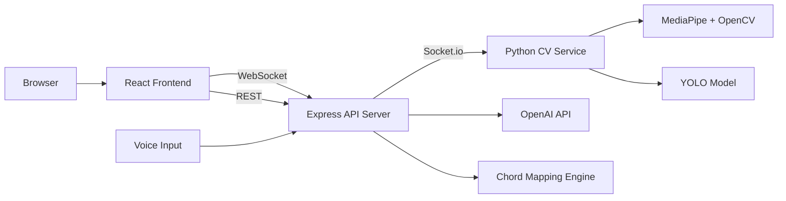

# StrumSpace — AR Guitar Learning Platform

An interactive guitar learning app that uses computer vision to detect hand positions in real-time, maps them to chords, and renders visual feedback on a 3D fretboard. Built for beginners who want immediate, visual guidance while learning guitar.

## Features

- **Real-time chord detection** — OpenCV + MediaPipe track finger placement on the guitar neck via webcam, with a YOLO model trained to recognize chord shapes
- **3D fretboard visualization** — Three.js-powered interactive fretboard that highlights correct finger positions for each chord
- **Voice-to-chord** — Hum or sing a melody and get matching chord suggestions
- **AI-assisted learning** — OpenAI API integration for music theory explanations and practice recommendations
- **Live feedback loop** — WebSocket connection streams CV predictions to the frontend in real-time

## System architecture



## Tech stack

| Layer | Technology |
|-------|-----------|
| **Frontend** | React 19, Vite, Three.js (React Three Fiber), Socket.io Client |
| **API Server** | Node.js, Express, Socket.io |
| **Computer Vision** | Python, OpenCV, MediaPipe, YOLOv8 |
| **AI** | OpenAI API |
| **3D Rendering** | Three.js, @react-three/drei |

## How it works

1. **Webcam captures hand position** — the Python CV service processes the video feed using MediaPipe for hand landmark detection and a custom-trained YOLO model for chord shape recognition
2. **Predictions stream to frontend** — Socket.io pushes detected chord data from the CV service through the Express server to the React client in real-time
3. **3D fretboard updates** — React Three Fiber renders the correct finger dots on an interactive fretboard, showing the user where to place their fingers
4. **Voice-to-chord pipeline** — audio input is processed to extract pitch/melody, which is mapped to suggested chord progressions

## Getting started

### Prerequisites
- Node.js >= 16
- Python 3.8+
- Webcam

### Install and run

```bash
# Frontend
cd frontend
npm install
npm run dev

# API server
cd strumspace-api
npm install
npm run dev

# CV backend
pip install -r requirements.txt
python backend/cv/main.py
```

## Project structure

```
strumspace/
├── frontend/          # React + Three.js client
├── strumspace-api/    # Express + Socket.io server
├── backend/cv/        # Python CV service (MediaPipe + YOLO)
├── voicetochord/      # Audio-to-chord pipeline
└── runs/detect/train/ # YOLO training artifacts
```
